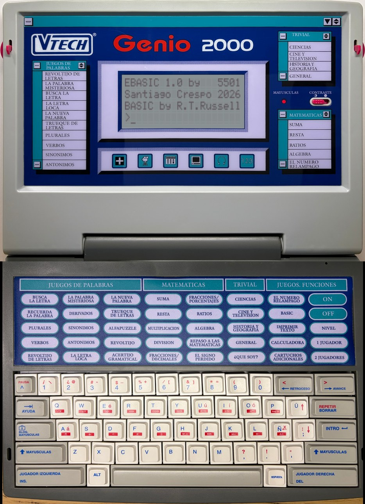
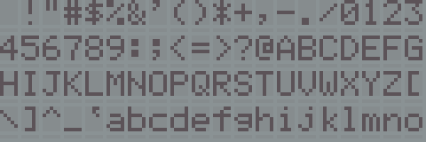
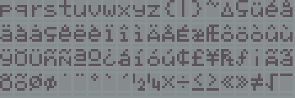
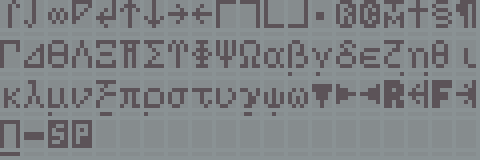

# VTech Genio 2000 (Spain)

Documentation, measurements and tools for the Spanish **VTech Genio 2000**, a 1990s educational laptop with a 4 x 20 character LCD, a matrix keyboard with an activity panel, a built-in BASIC and a cartridge port. The goal is preservation and emulation: the machine is being added to [MAME](https://github.com/mamedev/mame) as a clone of the Genius Leader 4000 (`src/mame/vtech/pc2000.cpp`).

## What is known
| | |
|---|---|
| CPU | Zilog Z84C0006 (6 MHz part); clock measured at about 6.13 MHz on the CLK pin (one unit) |
| Interrupt | IM 1 at 46.76 Hz, measured with a test cartridge on the real unit (about CPU clock / 2^17) |
| Memory | 128 KiB firmware ROM in 8 distinct banks of 16 KiB (window switching through ports 01/03), 8 KiB RAM at C000-DFFF (mirrored at E000) |
| Display | HD44780-type controller, 4 x 20 characters, own character set |
| Cartridges | 36-contact connector; autostart (`55 AA 59 45`) and menu (`55 AA 47 41` / `55 AA 11`) signatures |
| Printer port | a two-way serial link to a PC from a cartridge (transmit on DATA0, receive on BUSY), 2400-76800 baud, measured on the unit ([`docs/hardware/PRINTER_PORT.md`](docs/hardware/PRINTER_PORT.md)) |
| Firmware | two revisions known (two units): banks 0, 4, 5, 6 identical; 1, 2, 3, 7 differ |

Details, evidence levels and open questions are in [`docs/`](docs/README.md).

## MAME
The driver is submitted to MAME as a series of small pull requests. The first one is open: [mamedev/mame#16800](https://github.com/mamedev/mame/pull/16800). The firmware and the reconstructed character table are not part of the pull requests; they were sent to the MAME team separately (the character table is also in [`cgrom/`](cgrom/README.md)). Notes about the plan are in [`docs/mame/`](docs/mame/).

The photographic layout (later in the series, [`docs/mame/ARTWORK.md`](docs/mame/ARTWORK.md)) shows the emulated LCD inside photographs of the unit, with clickable keys. Here it runs the [EBASIC](https://github.com/kresp0/ebasic) cartridge:

## Character set (CGROM)
The LCD controller has its own character table, with Spanish letters, accents, mathematical symbols and Greek letters. It was rebuilt from photographs of the real LCD showing every code from 0x20 to 0xFF, three screens at a time. The same screens in MAME:

The result, [`cgrom/genio2000_cgrom_reconstructed.bin`](cgrom/genio2000_cgrom_reconstructed.bin) (4096 bytes, MAME `hd44780` format, SHA-1 `0ad6de16db67c014f44211dfd1328091be389cc7`), is what MAME's `genio2000` driver loads. It is not a read of the chip, so MAME marks it `BAD_DUMP`. How it was made, its limits and the photographs: [`cgrom/README.md`](cgrom/README.md) and [`docs/hardware/CGROM.md`](docs/hardware/CGROM.md).

## Repository layout
* [`docs/`](docs/README.md): hardware notes, firmware analysis, MAME notes.
* [`tools/`](tools/README.md): hardware test cartridge, analysis tools, MAME helpers. The ROM dumper is in its own repository, [vtech-genio2000-rom-dumper](https://github.com/kresp0/vtech-genio2000-rom-dumper).
* [`examples/`](examples/README.md): cartridge programs (a text editor, a PC serial link, a diagnostic cartridge, a scientific calculator, demos) and the VGLDK layer they build on.
* [`docs/DEVELOPING.md`](docs/DEVELOPING.md): how to write, build, test and burn your own cartridge.
* [`cgrom/`](cgrom/README.md): the LCD's character table, rebuilt from photographs, for MAME.
* [`photos/`](photos/README.md): the unit, its board and a memory cartridge.
* [`release/`](release/RELEASE_NOTES.md): ready-to-burn cartridge images (examples and the hardware test) with SHA-256 sums.
* [`AGENTS.md`](AGENTS.md): short rules for AI agents working here.

## Credits and licence
Code: BSD-3-Clause (the programs in `examples/` and the images in `release/` are GPL-3.0-or-later because they are built against VGLDK). Documentation, photographs and the character table: CC BY 4.0. See [`LICENSE`](LICENSE) and [`NOTICE.md`](NOTICE.md), which also describes the AI assistance used for the analysis tools and the text. The hardware work and all measurements are by Santiago Crespo.
