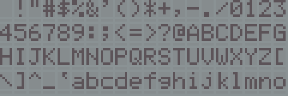
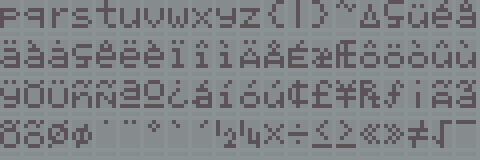
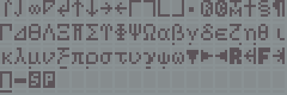
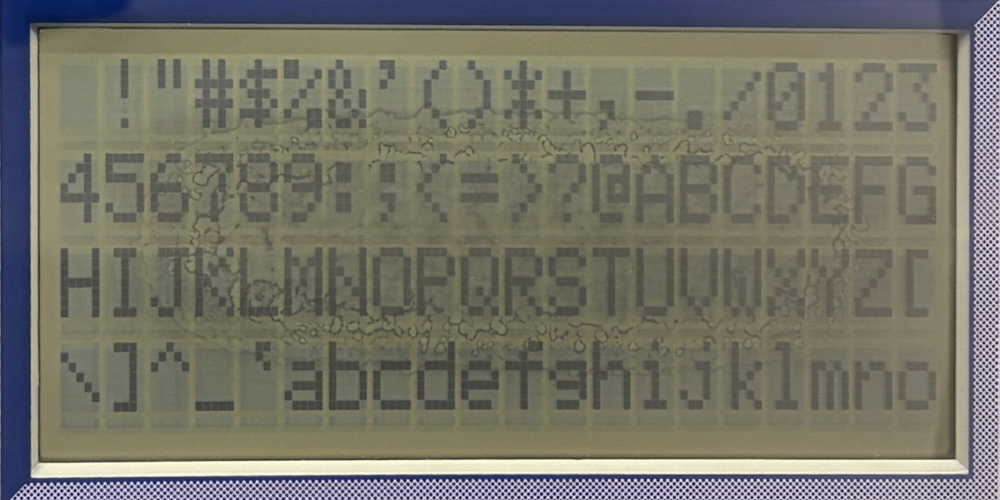
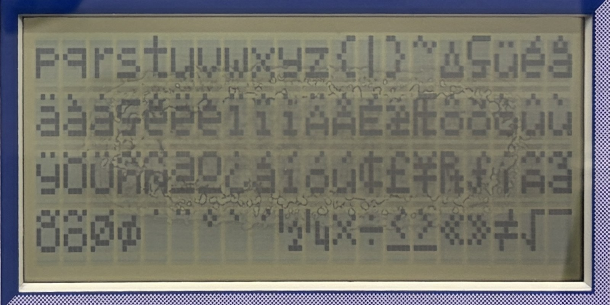
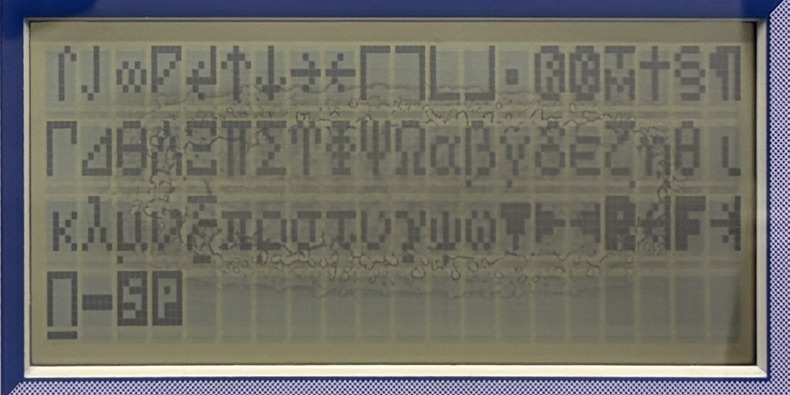

# Character set (CGROM) of the Spanish Genio 2000

The LCD controller of the Genio 2000 has its own built-in character table: not the HD44780 A00 table of the German Genius Leader 4000, but one with Spanish letters, accents, mathematical symbols and Greek letters. `genio2000_cgrom_reconstructed.bin` is that table, rebuilt from photographs of the real LCD. It is what MAME's `genio2000` driver loads.

Codes 0x20-0xFF (three screens of 80, 80 and 64 characters) drawn by MAME from the binary, with the diagnostic cartridge's character test ([`../examples/diagnostics/`](../examples/diagnostics/)):

The photographs of the real unit it was rebuilt from (perspective corrected; click to enlarge):

## The file
| | |
|---|---|
| Name | `genio2000_cgrom_reconstructed.bin` |
| Size | 4096 bytes = 256 entries x 16 bytes |
| CRC-32 | `1f712c25` |
| SHA-1 | `0ad6de16db67c014f44211dfd1328091be389cc7` |
| SHA-256 | `7e4ff917dff2529daab629bc132b9838dbd6ece5373288540091e20970745534` (also in `SHA256SUMS`) |
| Format | MAME `hd44780`: byte n of an entry is pixel row n, bit 4 = leftmost pixel; rows 0-7 in bytes 0-7; bytes 8-15 zero (5 x 10 mode was never seen); codes 0x00-0x1F zero |
| Version | "final reviewed", 2026-11-09 |

To use it in MAME, put it next to your own firmware dump in the `genio2000` ROM directory (or in `genio2000.zip`); see [`../docs/DEVELOPING.md`](../docs/DEVELOPING.md) section 4. MAME lists it as `BAD_DUMP` ("NEEDS REDUMP") because it is not a read of the chip.

## How it was made
* A cartridge program showed codes 0x20-0xFF on the unit, three screens as above, and the owner photographed them (2026-11-08, one unit). The identity of each code was confirmed on the unit.
* A pipeline corrected the perspective of each photo, fitted the dot grid and classified every one of the 8960 pixels (224 codes x 5 x 8) as lit or not, with a confidence for each.
* The result was reviewed by hand, glyph by glyph, against the photos: 1305 pixels in 199 glyphs were set by hand, each with a log entry. After the review all pixels are marked verified.
* MAME's automatic tests check that the three screens of that program are drawn from the binary pixel for pixel, and that the start-up screen of the firmware (`¡Hola!`, code 0xA9 for `¡`) matches the unit.

More detail, including which glyphs use the eighth pixel row and the differences from the A00 table: [`../docs/hardware/CGROM.md`](../docs/hardware/CGROM.md).

## Limits
* **It is not a dump.** The pixels come from photographs, not from reading the controller. Its makers are not known (it may not be a Hitachi part).
* A stain on the unit's LCD covers the middle of the screen (visible in the photos above); 45 glyphs were low-confidence before the manual review. The review's estimate is under one wrong pixel in the whole table, but that rests on the owner's judgement of ambiguous pixels.
* Codes 0x10-0x1F were blank on the unit but were not photographed; they are zero in the file. Codes 0x00-0x0F are the CGRAM (user-defined characters) and are not part of the table.
* Not compared with an authentic `hd44780_a00.bin`.
* What would close the gaps: straight-on photos of the low-confidence codes, at two exposures, a repeat on another day, or a second unit.

## Licence
The binary, the photographs and this document: CC BY 4.0, copyright (c) 2026 Santiago Crespo. The glyph designs are those of the LCD controller's maker; the VTech name and printed artwork in the photographs belong to their owners. See [`../NOTICE.md`](../NOTICE.md).
