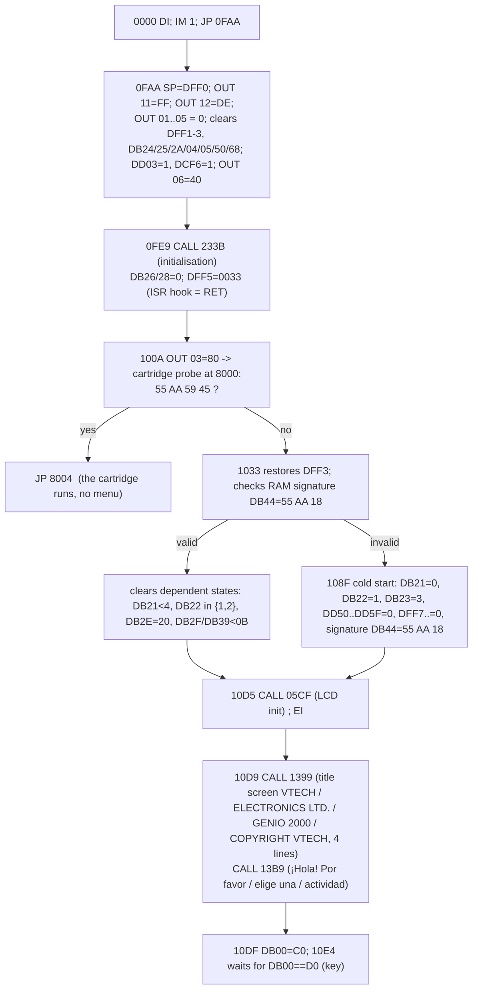

# BOOT_SEQUENCE: from reset to the main screen

Everything CONFIRMED in code (addresses in bank 0) unless stated; timing = EMU.

## Details
* **Stack**: `SP=DFF0` (0FAA). Port reset: 0x11=FF, 0x12=DE (0FAF-0FB3), 0x01-0x05=0, 0x06=40.
* **Cartridge probe at power-on**: sets `OUT (03),80` (cartridge page 0), compares `55 AA 59 45` at 8000-8003; if equal, it restores the port and does `JP 8004` (1012-1030). Otherwise it restores `DFF3`. See CARTRIDGE_INTERFACE.
* **Valid RAM**: if `DB44..DB46 == 55 AA 18` the state is kept (warm start: levels/names, for example); otherwise it initialises the variables (cold start) and writes the signature. On the real unit the owner observed that after OFF+ON the title always appears (RAM lost / cold start), consistent with OFF cutting the RAM supply: **HYPOTHESIS** (the signature does not persist).
* **Title screen** (1399-13B8): `CALL 009B` (clear), centring of 4 length-prefixed strings (0x00AD/B0/B3/B6) and `CALL 0098` with A=0 (sound/melody, PROBABLE). Then 13B9: second screen ("¡Hola! Por favor / elige una / actividad").
* **Key wait**: `DB00=C0` and a loop `10E4-10E9` until the ISR scan leaves it at `D0`. EMU: 706,213 loop iterations in the idle trace (25 emulated seconds).
* **Timing** (EMU, not HW): pause title -> "¡" 2.68 s and typing of the welcome message 5.45 s, measured on the unit (project notes); not measured again here.

## HW (2026-11-10)
* The RAM is **not** zeroed at start-up (pattern `70 C1 07 1C` in 72 %); only the variables listed above. When a YE cartridge is entered: `IFF2=0`, `DFF3=80`, `DFF4=14`, `DFF5/6=0033`, `DB00=C0 DB01=B4`, and `DCA0` already contains the text of the title screen although, according to this flow, the title is drawn *after* the cartridge probe: PROBABLE that it is **residual RAM from an earlier start** (RAM survives a short restart/power-off), not from this start. The origin of the `70 C1 07 1C` pattern (SRAM at power-up or leftover) is UNKNOWN.
* The **ON** key is separate from the matrix and restarts the unit; with a YE cartridge inserted the cartridge runs again from its start.

## Soft restart (RST 30h -> 11E6, CONFIRMED)
`SP=DFF0; OUT 01-05=0; DFF1-3=0; DB2A=0; DB50=0; DB68=0; OUT 06=40; DFF5=0033; EI; CALL 233B; JP 10E4`. Equivalent to "back to the menu" without going through the cartridge probe or the title. Use by cartridges: see CARTRIDGE_DEVELOPMENT.
