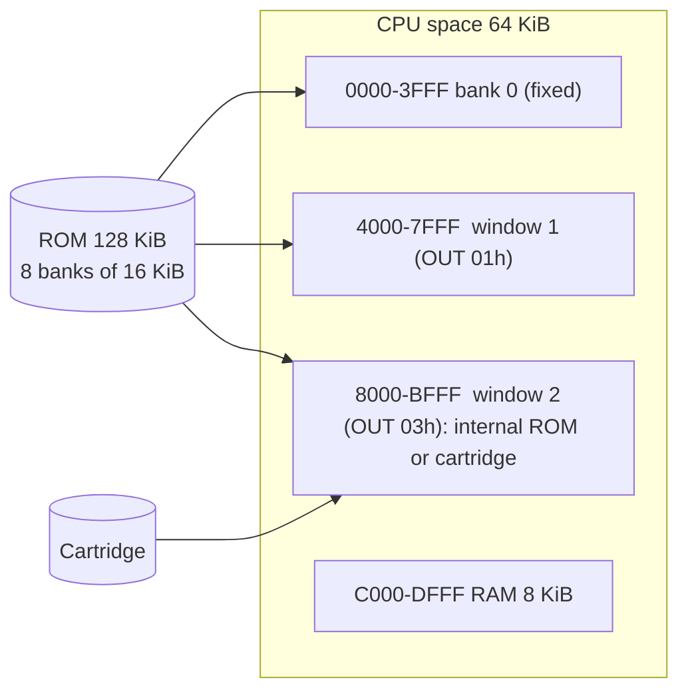

# FIRMWARE_OVERVIEW

## Identity (CONFIRMED unless stated)
* Image: 131,072 B, SHA-256 `f66f4d51...e5ea48`, CRC32 `7A9D7B8A`, SHA-1 `76e41bc3...0f`, MD5 `b4992b18...`. It is 8 banks of 16 KiB, **all different** (per-bank SHA-256 computed by `romid.py`). Identical byte for byte to the `27-5575-00` file of the MAME set and to the verified `bank_0..7.bin`.
* Origin: dumped through the printer port (soft UART) with a modified cartridge; 2 independent sessions agree (HW). **The dumper is not part of this image** (it runs at 0x8000 of the cartridge and only reads).
* The physical capacity of the chip (LH531H7H, mask ROM 27-5575-00 according to photographs of the board) is **not proven**; what is proven is that port 0x01 only shows 8 distinct banks (selectors 0-0x1F -> bank = selector & 7, HW).
* CPU: **Z80** (Zilog Z84C0006, from photographs of the board, `docs/hardware/HARDWARE.md`). Consistent with the code: all bytes decode as Z80 instructions and the own disassembler agrees with MAME `unidasm` on 87,985 of 87,995 compared instructions (the 10 differences are undocumented forms in data areas; `check_dis.py`).
* Identification text in the ROM: `VTECH`, `ELECTRONICS LTD.`, `GENIO 2000`, `COPYRIGHT VTECH` (0:13F5...). There is no legible version string or date (search for `19[89]x`, `version`, `(C)`, `Microsoft`: no useful results in code).

## Architecture (summary)

All the firmware (menu, educational activities, BASIC, word processor/calculator) lives in those 8 banks. Bank 0 holds the core (vectors, ISR, keyboard, LCD, utilities, start-up). Bank 7 holds BASIC and the RST 10h-28h stubs; it occupies window 0x4000 while BASIC runs (`DFF1`=7 in EMU). `DFF4` (bank the ISR selects before calling its hook) is 0 at rest (EMU) and 7 when BASIC installs its hook (`7036`, code at 7:6F2D).

## Main findings
1. **The ISR (IM 1, 0x0038->0x0119) does the work**: it scans the keyboard matrix and refreshes the LCD from a shadow buffer in RAM (`DCA0...`). The LCD is never written "live" by ordinary user programs (there are a few direct writes in banks 5/6). See LCD_INTERNALS, KEYBOARD_INTERNALS.
2. **Public API in bank 0**: a table of 74 3-byte `JP` at 0x003B-0x0116 (printing, cursor, clearing, strings, sound, keyboard...). Heavily used by banks 5/6/7 (up to 106 calls to the same entry). See FIRMWARE_API.
3. **Cartridges**: detection by `55 AA` signature. At power-on: `55 AA 59 45` ("YE") -> `JP 8004`. From the CARTUCHOS ADICIONALES key: `55 AA 11` -> internal data-cartridge routine; `55 AA 47 41` ("GA") -> `JP 8004`. See CARTRIDGE_INTERFACE.
4. **BASIC**: keyword table with the first letter in bit 7 ("Microsoft" style), 32-bit floating point numbers (constant pi/2 = `DB 0F 49 81`), table dispatch at `B7:5822`, **without PEEK/POKE/CALL/USR/OUT/INP/WAIT/DEF**: 55 of the 123 table entries are blanked and their handlers point to RAM stubs -> `SYNTAX ERROR`. See BASIC_*.
5. **Internal text encoding**: ASCII + CP437/850-style codes for the Spanish characters (AD=¡, A8=¿, A4=ñ, A5=Ñ, A7=º), translated to LCD CGROM codes at write time (0:07A8). See LCD_INTERNALS.
6. **Banks 1-4**: 1 and 4 carry a `55 AA` header and are databases of questions (1,066) and words (2,601) encoded by bits, read by `B0:0C13` (CONFIRMED, extractor `extract_data_banks.py`); 2 and 3 are high-entropy data in another format (UNKNOWN). All are accessed as *data* through window 0x8000 (`OUT (03)`). See DATA_FORMATS.

## Coverage reached (see DISASSEMBLY.md)
Bank 0 about 81 % of bytes as code, bank 5 about 85 %, bank 6 about 58 %, bank 7 about 63 %, banks 1-4: 0 % code (data). The analysis is not declared complete: see UNRESOLVED_QUESTIONS.

## Update 2026-11-10
* There are **two revisions** of this ROM (ROM_REVISIONS): banks 0, 4, 5 and 6 identical; 1, 2, 3 and 7 differ (14 questions corrected, 1 code byte in BASIC). This document describes unit 1.
* Measured on HW (HW_RESULTS_20261110): CPU about 6.10-6.13 MHz, IRQ 46.76 Hz (about clock/2^17), RAM mirrored at E000, port 03 = the same 8 banks as 01, `HALT` switches the unit off, ON is separate and restarts.
