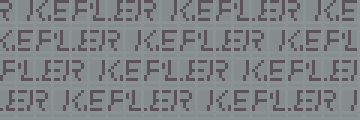
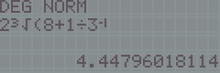
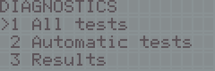
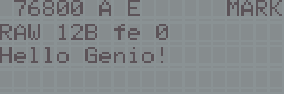
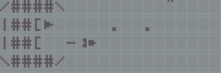
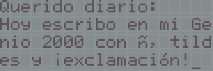

# Examples

| | Program | What it is |
|---|---|---|
|  | [`kepler-demo/`](kepler-demo/) | A music and animation demo |
|  | [`calculator/`](calculator/) | A scientific calculator |
|  | [`diagnostics/`](diagnostics/) | A diagnostic cartridge: CPU, RAM, ROM, interrupt, LCD, keyboard, sound, LED |
|  | [`pc-link/`](pc-link/) | A serial link from a PC through the printer port |
|  | [`readysetgo/`](readysetgo/) | READY, SET, GO!, a demo with sprites and music |
|  | [`text-editor/`](text-editor/) | A text editor with serial export |
| | [`vgldk-genio/`](vgldk-genio/) | The Genio 2000 layer for VGLDK that the text editor needs |

Every program has been tested on a real Genio 2000; its README says how, and shows more MAME snapshots.

All of them are built with [VGLDK](https://github.com/hotkeymuc/vgldk), which is **not** included: use an unmodified clone at commit `6fbd389ace4c7bf156cb2c3fafafb1acf4a2a857`. See [`../docs/DEVELOPING.md`](../docs/DEVELOPING.md).

## Licence
VGLDK is GPL-3.0 and these programs are built against its headers, so everything in `examples/` is released under **GPL-3.0-or-later** (copyright (c) 2026 Santiago Crespo; VGLDK headers belong to their authors). The BSD-3-Clause licence of the top-level `LICENSE` covers the rest of the repository's code.

Built images are in [`../release/`](../release/RELEASE_NOTES.md) with their checksums; you can also build them yourself. Burn them to your own EEPROM.
