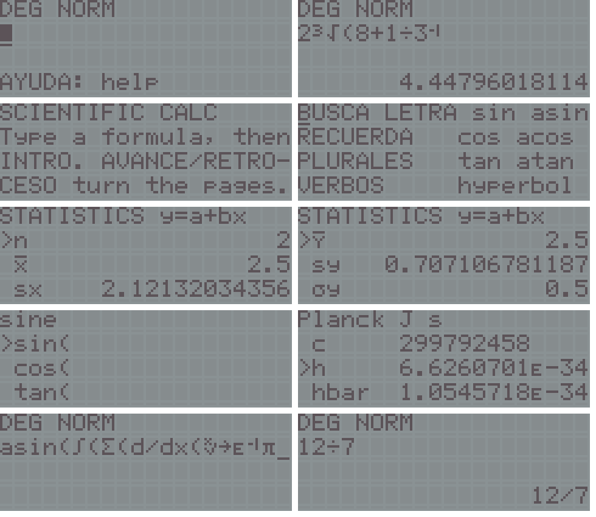

# calculator: scientific calculator for the VTech Genio 2000 (Z80 at about 6.13 MHz)

A cartridge (autostart `55 AA 59 45`) that turns the Genio into an algebraic scientific calculator: you type the whole formula on a two-line editor and press INTRO. It uses **two 16 KiB pages of a 32 KiB AT28C256**: page 1 (selector `0x80`) is the program, page 2 (selector `0x83`) holds data only (the math microcode, copied to RAM at start, and all the help and list texts).



**Machines.** It is written for the Spanish VTech Genio 2000 and will most likely also run on its relatives the Genius 4000, Genius LEADER 4000 Quadro, Genius LEADER 4004 Quadro L and PreComputer Power Pad, but it has only been run on the Genio 2000 (see **Status**); their keyboards carry other legends, so the key names below and in the help are those of the Spanish unit. The activity-panel keys sit at the same matrix positions on those models only if their panels match.

## What it does
* **Entry**: the formula as you would write it, on rows 1-2 (up to 120 characters, scrolling), the result right-aligned on row 3, the modes on row 0. Correct precedence (`2+3x4 = 14`, `-2^2 = -4`, `2^3^2 = 512`), implicit multiplication with priority (`1/2pi = 1/(2pi)`, `2A`, `3(4+5)`), postfix `x^2 x^3 x^-1 ! %`, missing `)` closed at the end. After a result an operator key continues from `Ans`; INTRO on an empty line repeats the last one; a history of the last lines (512 bytes). Syntax errors put the cursor where the problem is.
* **Numbers**: 16-digit **decimal** floating point (one digit per byte), rounded half up, exponent up to `9.99E499` (`253!` fits, `254!` is Overflow). 12 digits are shown, so `0.1+0.2` is exactly `0.3` and `1/3x3` is `1`.
* **Functions**: sin cos tan asin acos atan (DEG / RAD / GRA; `sin 180 = 0` exactly, the reduction is done in the angle unit), the six hyperbolics and their inverses, ln log e^x 10^x, any power and root (`(-8)^(1/3) = -2`), square and cube root, x! and gamma for non-integers, nCr nPr, gcd lcm mod, abs int frac floor, rnd (round as displayed), max min, rand ranint, and or xor not (32 bits).
* **Calculus** on a formula in `X`: `solve(f,guess)` (secant method; `f` may be an equation `lhs=rhs`; the root is stored in X), `integral(f,a,b)` (Gauss-Legendre, 5 points per panel, the panels double until two sums agree to 10 digits), `d/dx(f,x)` (Richardson extrapolation of central differences), `sum(f,a,b)`. BORRAR stops a long calculation.
* **Display**: NORM (12 digits), FIX 0-9, SCI 1-10, ENG; the result as a fraction (`a/b`, continued fractions, denominators below 10^6) or in degrees-minutes-seconds; integer bases HEX BIN OCT (typed in that base: `0FF`; two's complement, 32 bits).
* **Memories** A-Z and Ans (`5->A`), a **list of 34 constants and units** (CODATA 2018: c, h, hbar, e, me, mp, mn, u, NA, k, R, F, G, g, eps0, mu0, sigma, a0, Rinf, Vm, atm, 0 C; inch, foot, mile, nautical mile, lb, oz, US gallon, cal, eV, light year, au, hp), **statistics** with one or two variables (n, means, sample and population deviations, sums, the line `y = a + bx` and r), a **catalog** of all the functions with a line of help each.
* **Help** (AYUDA): 56 pages: keys, every activity-panel key (press a panel key inside the help to jump to its line), function reference, examples, errors. Everything on screen is in English; key names are the Spanish legends printed on the keys.
* **OFF** switches off at once; without a key for about 6 minutes it switches itself off. The caps LED is lit while a calculation runs; errors beep.

## Keys
Main keyboard: digits, `.`, `,`, letters A-Z are memories (with MAYUSCULAS: small letters, to type function names such as `gamma(`). INTRO = result, RETROCESO / AVANCE move (with MAYUSCULAS: start / end), JUGADOR DERECHA / DEL erases to the left (with MAYUSCULAS: under the cursor; a function name goes as a whole), JUGADOR IZQUIERDA / INS insert or replace, REPETIR / BORRAR clears the line, RESPUESTA types `Ans`, ALT+Ü / ALT+; history, AYUDA help. MAYUSCULAS+5 `%`, +6 `/`, +8 `x`, +9 `(`, +0 `)`, +. `!`; ALT+3 `-`, ALT+5 `+`, ALT+8 `=`; `'` is `^`.

Activity panel (key / with MAYUSCULAS held):

| Panel key | | Panel key | |
|---|---|---|---|
| BUSCA LA LETRA | sin / asin | SUMA, RESTA, MULTIPLICACION, DIVISION | + - x / |
| RECUERDA LA PALABRA | cos / acos | FRACCIONES / DECIMALES | result as a fraction |
| PLURALES | tan / atan | FRACCIONES / PORCENTAJES | % / mod |
| VERBOS | HYP (next trig key is hyperbolic) | RATIOS | nCr / nPr |
| REVOLTIJO DE LETRAS | DEG RAD GRA / result in deg-min-sec | ALGEBRA | solve / d/dx |
| LA PALABRA MISTERIOSA | ln / e^ | REPASO A LAS MATEMATICAS | history back / forward |
| DERIVADOS | log / 10^ | EL SIGNO PERDIDO | abs / int |
| SINONIMOS | square root / cube root | CIENCIAS | constants list |
| ANTONIMOS | x^-1 / x! | CINE Y TELEVISION | display format |
| LA LETRA LOCA | x^2 / x^3 | HISTORIA Y GEOGRAFIA | add data point / statistics |
| LA NUEVA PALABRA | ^ / x-th root | GENERAL | function catalog |
| TRUEQUE DE LETRAS | ( / , | ¿QUE SOY? | memories list |
| ALFAPUZZLE | ) / store -> | EL NUMERO RELAMPAGO | rand / ranint |
| REVOLTIJO | pi / e | BASIC | DEC HEX BIN OCT / back to DEC |
| ACERTIJO GRAMATICAL | x10^ (E) / rnd | IMPRIMIR TEXTO | integral / sum |
| CALCULADORA | X / = | CARTUCHOS ADICIONALES | gcd / lcm |
| NIVEL | clear all (asks) | 1 JUGADOR, 2 JUGADORES | max / min, and / or |

## How it works
* **Arithmetic** (`dec.h`, `core_z80.h`): a number is a sign, a 16-bit exponent and 16 digits, 19 bytes. Addition aligns into a 19-digit work buffer, multiplication is schoolbook with a per-row table of `x * 0..9`, division is long division by repeated subtraction (18 quotient digits), and everything ends in one rounding routine (`pack`). The cartridge runs these in hand-written Z80 assembly; the same functions in C (`dec.h`) are what the host tests compile.
* **Functions are microcode** (`gen_vm.py`): a small stack machine with 50 one- to four-byte instructions (`vm.h`), so a function that would take hundreds of bytes of SDCC code takes tens. exp uses `10^k e^s` with ln10 split in two parts (Cody-Waite) and a Taylor series; ln reduces to `[0.5, 1.5)` and sums `2 atanh((m-1)/(m+1))`; sin/cos reduce by quarter turns in the angle unit and use Taylor series on `[-pi/4, pi/4]`; atan uses `pi/6 + atan((x sqrt3 - 1)/(x + sqrt3))`; sqrt is Newton from above; gamma is Stirling's series at `[15, 16)` and the recurrence; `x^y` is exact for integer y and `10^(y log x)` with the integer part of the exponent split off. Calculus, statistics, fractions and deg-min-sec are microcode too.
* **The evaluator** (`eval.h`) is precedence climbing straight over the text, without tokens: the calculus functions skip their first argument and evaluate it again for every X by moving the text pointer back, and that can nest.
* **Page 2** (`gen_tables.py`): a 4-byte signature, the microcode (2600 bytes, copied to RAM at start), its 54 constants (read 19 bytes at a time when used), then tables of addresses and the strings (help, catalog, constants, the text each key types). An 11-byte routine in RAM selects page 2 (`OUT (0x03), 0x83`), copies with LDIR and selects page 1 again (`0x80`); interrupts are always disabled.
* **Screen** (`calc_gl2000.c`): a shadow of the 80 cells; only the changed cells are written, 56 us apart (341 T-states, the HD44780 needs about 40); 8 CGRAM glyphs (x^-1, ^2, ^3, ->, integral, sigma, the exponent mark E and x-th root), three of them redefined while the statistics list is open (x mean, y mean, sigma). The hardware cursor shows the insertion point (blinking block; underline when replacing).
* **Keyboard**: the 8 x 13 matrix is scanned directly (ports 0x10/0x11), a key counts when two scans 6 ms apart agree; RETROCESO, AVANCE and DEL repeat after 0.45 s. The random generator is stirred by the time you take between keys.
* **Memory**: globals C000-D515 (the microcode is 2600 of them), number stack of 40 entries for the microcode, the processor stack below DFF0. The evaluator stops with "Too complex" before the stack reaches D780 (2160 bytes); 40 nested parentheses and nested integrals work.

## Build and test
```bash
make VGLDK=/path/to/vgldk     # an unmodified clone at commit 6fbd389; default ../../third_party/vgldk
```
Needs `sdcc` 4.5, `makebin`, `python3` with `mpmath` (only to compute the constants and for the tests) and Pillow for `tests/sheet.py`. Only VGLDK's `cart_crt0.s` is used (none of its drivers); the code is built with `--opt-code-size`. It produces:
* `calc_gl2000_AT28C256_32K.bin`: page 1 then page 2, for the EEPROM.
* `calc_gl2000_mame_64K.bin`: the same 32 KiB twice, for MAME's `-cart` (MAME maps selector `0x8n` to `n * 16 KiB` without mirroring).
* `out/`: the SDCC output; `page2.bin`, `consts.h`, `tables.h`: generated.

Page 1 uses 16 279 of its 16 384 bytes (105 free; `python3 sizes.py` lists the functions by size); page 2 uses 10 309.

`make test` (with `GENIO_MAME` = a MAME with the genio2000 driver and `GENIO_ROMPATH` = your own ROMs) runs `tests/run_all.sh`:
* `tests/test_math.py`: the C version of the arithmetic, microcode and evaluator (`tests/host`) against mpmath: 95 fixed cases (results, errors, parser), 17 display-format cases, 13 fraction / deg-min-sec / base cases, and 1400 random ones over every function. Worst relative error: at most 2.1e-15 for every function except `x^y` (2.4e-14) and gamma / `x!` (1.9e-14), where the size of the result eats digits of `y log x`; the display shows 12 digits.
* `tests/mame_math.py`: the same expressions (620) typed into the cartridge in headless MAME; the 16 digits, the exponent and the display must equal the host's. This is what checks the Z80 assembly.
* `tests/ui.txt` (59 checks with real key presses: panel keys, MAYUSCULAS and ALT combinations, editing, history, modes, formats, bases, calculus, statistics, constants, help, clear all, OFF) and `tests/break.txt` (BORRAR during an integral, OFF during a calculation), and `tests/nopage2.txt` (an image with a blank second half gives the message and OFF still works).
* `tests/edge.txt` (results logged), `tests/shots.txt` + `tests/sheet.py` (the picture above).

## Status
* **Tested on a real unit** by the author: it works, including the second page (selector 0x83).
* **Verified in MAME** (headless, the `genio` build of mame-upstream): every test above passes; port 0x12 is written only with bits 3 (speaker) and 5 (LED) except the single power-off write; port 0x03 only with 0x80 and 0x83 (the firmware writes 0x00 before the cartridge starts); there is one HALT, in the power-off sequence. Timing in MAME: `+ - x /` instant, sin/ln/e^x 0.1-0.5 s, `253!` 4 s, an integral of sin in degrees 11 s, a nested integral 26 s.
* Assumptions that MAME cannot check (they held on the tested unit):
  * **The second page.** Page 2 is selected with bit 1 of port 0x03 (A14 of the EEPROM on the RevD board, measured on the unit, [`HW_RESULTS_20261110.md`](../../docs/firmware/HW_RESULTS_20261110.md) #3); this calculator is the first program that read the second half on the real unit. If it fails on another unit or board, the program finds no signature at the start of page 2 and says "Page 2 (0x83) of the cartridge is missing" instead of starting (OFF still works).
  * The firmware is assumed to start the cartridge with bit 1 of the selector at 0 (page 1); MAME agrees.
  * LCD timing: 56 us between writes without reading the busy flag; init with 5 ms between commands. MAME does not check either.
  * The keyboard is read without the firmware: MAYUSCULAS/ALT combinations were measured on the unit only as single keys (`KEYBOARD.md`); ghosting with three keys is possible.
  * MAME zeroes RAM at power-on; the program assigns every global before use (VGLDK's crt0 runs no initialisation), but that cannot be proven in MAME.
  * No undocumented opcodes are used. The assembly uses IY (ddivn).
* MAME does not model the LCD's persistence or the LED's brightness; the "Working..." line appears only when a calculation evaluates a formula repeatedly (calculus).

Licence: GPL-3.0-or-later (it is built against VGLDK, see `../README.md`).
