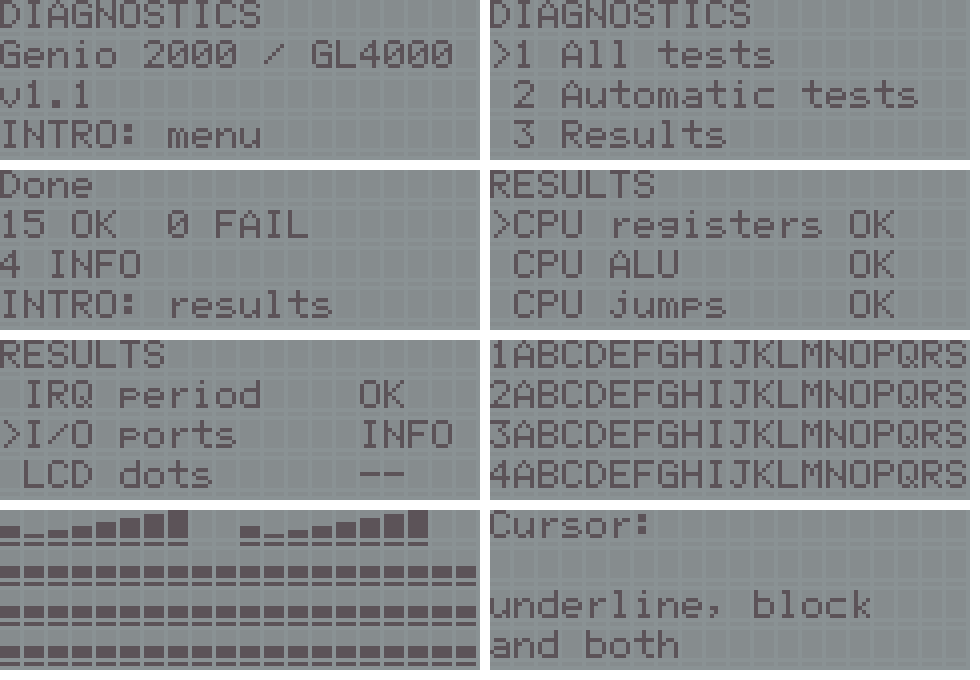

# diagnostics: diagnostic cartridge for the VTech Genio 2000 (Z80 at about 6.13 MHz)

A 16 KiB cartridge (at 0x8000, autostart `55 AA 59 45`; it uses 14.3 KiB) that tests the whole machine from a menu: the CPU, the 8 KiB of RAM, the cartridge and internal ROM, the periodic interrupt, the ports, the LCD, the keyboard, the speaker and the caps-lock LED. Automatic tests decide OK / FAIL by themselves; interactive ones show something and ask you: INTRO = yes, N = no, REPETIR (REPETIR / BORRAR) = run the test again. Every result is kept in a result list with a one-line detail.



The user interface is in English; keys are called by the Spanish legends printed on them (INTRO, RESPUESTA, AVANCE, RETROCESO, REPETIR...). It should also run on the Genius 4000, Genius LEADER 4000 Quadro, Genius LEADER 4004 Quadro L and PreComputer Power Pad, but it has only been run on the Genio 2000 (see **Status**).

## Menu
The title screen waits for a key; then:

| Key | Entry | What it does |
|---|---|---|
| 1 | All tests | the 19 automatic tests, then the 9 interactive ones, then a summary (INTRO opens the result list) |
| 2 | Automatic tests | the 19 automatic tests and the summary (about 7 s) |
| 3 | Results | the result list: status of each test; INTRO shows its detail line |
| 4 | CPU > | submenu: "All" (the group) or one test |
| 5 | RAM > | submenu |
| 6 | ROM > | submenu |
| 7 | System > | submenu: idle keys, interrupt, interrupt period, ports |
| 8 | LCD screen > | submenu: the six LCD tests |
| 9 | Keyboard | keyboard test |
| 0 | Sound | five notes |
| | LED | LED test |
| | Burn-in loop | repeats the automatic tests (except "Keys at rest" and "RAM at boot") until a key is **held**; counts passes and failures |
| | Power off | powers off |

AVANCE / ESPACIO move down, RETROCESO up, INTRO runs the entry, RESPUESTA goes back, a digit runs its entry at once. OFF powers the unit off whenever the program is waiting for a key (not in the keyboard test, where OFF is just another key, and not while a test is running).

## The tests
Automatic (`R` = result: OK / FAIL, or INFO when there is nothing to judge):

| Test | How | R |
|---|---|---|
| CPU registers | loads distinct values into BC DE HL A, the alternate set (EXX, EX AF,AF'), IX, IY, I; 8-bit moves through every register; PUSH/POP of every pair; SP must come back | OK/FAIL |
| CPU ALU | 33 operations (ADD ADC SUB SBC AND XOR OR CP INC DEC NEG CPL DAA, ADD/SUB+DAA, SCF CCF, RLCA RRCA RLA RRA, RLC RRC RL RR SLA SRA SRL, BIT 0/7, ADD/ADC/SBC HL,DE) x 64 operand/flag vectors; a CRC-16 of A, the documented flags (S Z H P/V N C; only Z H N C for BIT), H and L must equal the one `gen_tables.py` computes from its own model of the documented Z80 behaviour. The detail names the first failing operation | OK/FAIL |
| CPU jumps | JP/JR/CALL/RET on Z NZ C NC P M PE PO, DJNZ, JP (HL)/(IX)/(IY), EX DE,HL, EX (SP),HL, PUSH/POP AF | OK/FAIL |
| CPU block ops | LDIR, LDDR, an overlapping LDIR fill, CPIR (found and not found), CPDR, LDI, RLD, RRD: registers, flags and memory | OK/FAIL |
| CPU indexed | (IX+127), (IX-128), (IY+d) with LD/INC/DEC/SET/RES/BIT, ADD IX,DE, ADD IY,IY, EX (SP),IX | OK/FAIL |
| CPU R and I | R advances by 5 over `LD A,R / LD B,A / NOP / NOP / LD A,R`, keeps bit 7, wraps its 7 bits; I reads back; LD A,I gives P/V = IFF2 = 0 | OK/FAIL |
| RAM data bus | walking 1 and walking 0 at C400, CAAA, D555, DAFF | OK/FAIL |
| RAM address | every byte of C400-DAFF holds the XOR of its address bytes, then the inverse (any stuck or shorted address line A0-A12 changes the value read) | OK/FAIL |
| RAM march 8K | March C- (up w0; up r0 w1; up r1 w0; down r0 w1; down r1 w0; r0) with backgrounds 00/FF, 55/AA, 33/CC, 0F/F0 over **all of C000-DFFF**, see below | OK/FAIL |
| RAM mirror | writes C400-C4FF and only reads E400-E4FF: on the unit the RAM is mirrored at E000-FFFF (HW, [`HW_RESULTS_20261110`](../../docs/firmware/HW_RESULTS_20261110.md) #4), MAME leaves it unmapped | INFO |
| RAM at boot | measured before anything writes C400-DAFF: share of 4-byte words equal to `70 C1 07 1C` (the pattern the unit leaves, HW #6) and of zero words (MAME clears the RAM) | INFO |
| ROM cartridge | header `55 AA 59 45` and the CRC-32 of 8000-BFFB against the one `mkcart.py` stored at BFFC | OK/FAIL |
| ROM page 81 | from RAM: maps cartridge page 0x81 with port 0x03, sums 8000-BFFF, maps 0x80 back; the sum must equal page 0x80's (the image is the same 16 KiB twice) | OK/FAIL |
| ROM internal | CRC-32 of 0000-3FFF against D49DECF0 (bank 0, the same in both known firmware revisions) | OK/FAIL |
| ROM window 1 | CRC-32 of 4000-7FFF, named from the 12 known bank CRCs of both units (a bank 1, 2, 3 or 7 there would also tell which revision the unit has) | INFO |
| Keys at rest | asks you not to touch the keyboard, then no key of the matrix may read as pressed | OK/FAIL |
| Interrupt | IM 1 with the firmware's ISR and a hook at DFF5 (the method measured on the unit by [`hwtest`](../../tools/hwtest/README.md) stage D): 18 interrupts must arrive, IFF2 must be 0 before EI and 1 after, the firmware tick counter DB28 must advance by 18, the intervals must not vary by more than 3 loop passes, and the rate must be 40-56 Hz. The rate is approximate ("~"): the ISR's own time is not counted, so it reads about 1 % high | OK/FAIL |
| IRQ period | the exact period in T-states, see below | OK/FAIL |
| I/O ports | `IN` of 0x10, 0x11, 0x12 at rest (the unit gives FF, 5F, 16; MAME FF, FF, D6) | INFO |

Interactive (the program shows, you judge): **LCD dots** (every dot of the 80 cells on, 8th row included), **LCD checker** (a checkerboard that inverts eight times), **LCD order** (rows 1-4 and letters A-S: checks the 4x20 DDRAM map), **LCD charset** (three pages with codes 20-FF; compare with [`docs/hardware/CGROM.md`](../../docs/hardware/CGROM.md)), **LCD CGRAM** (8 user glyphs, codes 08-0F next to 00-07, and one glyph rewritten live so that 60 cells move together), **LCD cursor** (underline, blinking block, both), **Keyboard** (see below), **Sound** (C4 C5 C6 C7 G7, 0.4 s each), **LED** (on for 1 s, then 5 blinks).

**Keyboard**: shows the name, column and row of the key pressed and how many others are down at the same time, and counts the distinct keys seen out of 94 (55 main positions plus 39 activity-panel keys; ON is not readable). Hold RESPUESTA for about a second to leave. All 94 seen gives OK, fewer gives INFO "seen n/94".

## How the RAM test reaches all 8 KiB
The program keeps its variables in C000-C3FF; the stack and the firmware's variables are in DB00-DFFF; C400-DAFF is scratch that any test may destroy. `ram_full` (assembly, interrupts disabled) tests the scratch area first; then copies C000-C3FF and DB00-DFFF into the scratch area it has just tested, moves the stack there, tests C000-C3FF and DB00-DFFF, copies them back and restores SP. The firmware's shadows (DFF1/DFF3/DFF4/DFF5) and the return addresses on the stack are therefore intact afterwards.

## How the interrupt period is measured
`irq_count` is an 83 T-state loop that increments a counter; at every interrupt a routine stores the counter. The firmware ISR's duration is unknown, so "Interrupt" can only give an approximate rate. "IRQ period" uses IM 2 with its own routine instead: a 257-byte vector table at C500 full of `C6` (so any byte on the bus during the acknowledge works), `JP irq2_isr` at C6C6, and a routine whose every path is counted. Per interrupt it costs exactly 237 T (19 acknowledge + 10 JP + 208), so 16 periods = passes x 83 + 16 x 237 T. The first interval is dropped (an interrupt is usually pending when EI runs). `gen_tables.py` emits both routines from lists of (instruction, T-states) and asserts the sums (83, 237), as it does for the tone routine (68 + 26 n T per half period) and the millisecond delay (6139 T).

In MAME this gives exactly the emulated period, also when the emulator's experimental selectors change it (`tests/irq_matrix.sh`): 6.13179 MHz / 50 Hz -> 122636 T (expected 122635.8), 6.13179 MHz / 40 Hz -> 153294 T (153294.8), 3.0 MHz / 50 Hz -> 59997 T (60000), 3.0 MHz / 40 Hz -> 74999 T (75000). On the unit, the 46.76 Hz measured by `hwtest` and the 6.13179 MHz of the oscilloscope predict about 131 130 T; the hypothesis that the interrupt is the CPU clock divided by 2^17 predicts exactly **131072 T**. This test can settle that on the unit. The Hz shown next to it assume 6.13179 MHz.

## Build
```bash
make VGLDK=/path/to/vgldk   # an unmodified clone of VGLDK at commit 6fbd389
```
VGLDK's gl2000 profile trimmed to the LCD driver (no keyboard, sound or stdio code: VGLDK's `vgl_sound_off` would write port 0x12 without masking bit 0), with its own LCD map (`map4`), keyboard scan and power-off routine. `gen_tables.py` writes `tables.h` (ALU vectors and expected CRCs, CRC-32 tables, bank CRCs, key names, T-counted routines). `mkcart.py` checks that code stays below BFFC, that no library code lands in the `_HOME` area (it would be linked into RAM) and that the globals end before C400; it stores the CRC-32 at BFFC and writes `diag_gl2000_16K.bin` and `diag_gl2000_mirrored_AT28C256_32K.bin` (for MAME's `-cart` or an AT28C256). A clean rebuild gives the same bytes as the image in `release/` (`release/SHA256SUMS`).

## MAME tests
`GENIO_MAME=/path/to/mame GENIO_ROMPATH=/path/to/your/roms tests/run_all.sh` (a MAME with the `genio2000` driver and your own ROM dump; headless: no display, dummy SDL drivers, `-video none`; see `tests/run.sh`) drives the cartridge with `tests/drive.lua`, which presses keys on the emulated matrix, compares the program's shadow screen with the HD44780's own DDRAM, reads the result table through the linker map and logs every write to port 0x12. Scripts: `auto.txt` (the automatic tests, 22 checks), `all.txt` (everything, snapshots of every LCD pattern; LCD dots is repeated once with REPETIR, LED is answered N and must end as FAIL, the others yes), `menus.txt` (submenus, single tests, result list, burn-in loop, OFF), `sound.txt` (records `diag_sonido_mame.wav`), `faults.txt` with injected faults, `irq_matrix.sh` (needs the experimental CLOCK / IRQ switches of the `genio2000-dev` build). The logs go to `mame/`.

## Status
* **Tested on a real unit** by the author: it works, including the "IRQ period" test (the first use of IM 2 on this hardware).
* **Verified in MAME** (the `genio2000-dev` build, 50 Hz interrupt, RAM cleared at start): all 19 automatic tests pass (RAM mirror "no mirror", RAM at boot 0 % pattern / 100 % zero, window 1 = bank 0, ports FF FF D6, "IRQ period" 122636 T); every interactive screen was checked against the HD44780's DDRAM and in snapshots; the five notes measure 262.3, 522.6, 1047.0, 2082.7 and 3134.6 Hz in the WAV (within 0.02 % of the computed values); the only write to port 0x12 with bit 0 set is the power-off of OFF / Power off. Injected faults are caught: a RAM bit stuck at 0 at D234 (RAM address and RAM march report D234), one flipped bit in the cartridge (ROM cartridge and ROM page 81), a key held during "Keys at rest" (it names column 1 row 2 = Q). The ALU expectations come from a Python model and agree with MAME's Z80 core on all 33 x 64 vectors: two independent implementations, but neither is silicon.
* What the program does to the hardware (all of it ran without trouble on the tested unit):
  * "IRQ period" uses **IM 2** and sets I to C5 for about 0.4 s. The acknowledge cycle is the same as in IM 1 and the table accepts any vector byte. "CPU R and I" also writes I (5A, restored) and R. During those instructions the refresh cycles put I on A8-A15 (a C5xx or 5Axx address with /MREQ and /RFSH but no /RD or /WR).
  * "ROM page 81" writes port 0x03 (0x81, then 0x80) from RAM: allowed values; on the unit with a 32 KiB EEPROM page 0x81 shows the same content (HW #3).
  * "Interrupt" relies on the firmware ISR settings that `hwtest` stage D used on the unit (DB00 = D0, DB01 = F9) plus DCF0-DCF3 = 0 and DCF7 = 0 (LCD service quiet), all restored afterwards.
  * "RAM mirror" and "I/O ports" are expected to differ from MAME on the unit (mirror present; port 0x11 = 5F, 0x12 = 16); they are INFO, not pass/fail.
* Risks: LCD writes are at least 341 T (56 us) apart (the HD44780 needs about 40 us; the busy flag is not read and port 0x0A/0x0B are never read); a fast key tap during a long test is missed, so the burn-in loop asks for the key to be held; OFF is only polled while waiting for a key; the keyboard has no diodes, so with three or more keys held a ghost key may be counted in the keyboard test; the ALU test checks documented flags only (bits 3 and 5 are masked). No undocumented opcodes are used. No `HALT` except the one in the power-off routine; port 0x12 is always written with bit 0 = 0 (mask 0x28) except there; ports 0x00-0x02 and 0x04-0x06 are never written, 0x11 never written, 0x0A/0x0B never read.
* MAME does not model the LCD's persistence or contrast, the RAM's power-up content, the real interrupt rate (46.76 Hz on the unit, 50 Hz here) or the bit 6 of port 0x11.

Licence: GPL-3.0-or-later (it is built against VGLDK), copyright (c) 2026 Santiago Crespo; see [`../README.md`](../README.md).
