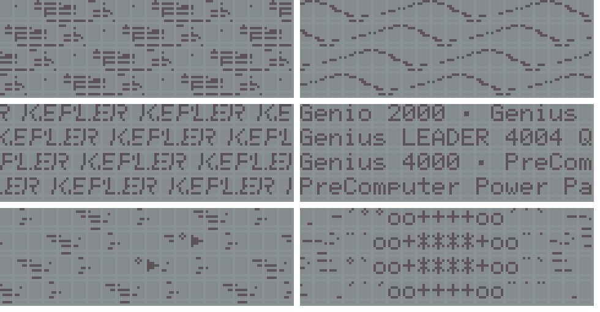

# kepler-demo: a Kepler 2000 demo that squeezes the Z80 (about 6.13 MHz)

A 16 KiB cartridge (at 0x8000, autostart `55 AA 59 45`; it uses about 15.9 KiB). It plays the Kepler 2000 music (about 45 s) **while** animating the LCD (CGRAM, ROM characters and the caps-lock LED), with interrupts disabled and 100 % of the T-states spread over a few loops of 256 T-states per iteration. At the end it switches the unit off.



## What the loops do (256 T-states = 41.7 us per iteration; `gen_demo.py` generates them with the exact count)
* **Audio**: 2 samples per iteration (16-bit phase accumulator -> square wave on bit 3 of port 0x12), fs about 47.9 kHz. Measured in MAME: every sample comes out exactly 128 T-states after the previous one.
* **CGRAM scenes** (warp, waves, KEPLER, jump): 1 write to the LCD per iteration (>= 37 us between writes, as the HD44780 requires). Each frame (71 iterations, 2.96 ms, about 337 frames/s) rewrites the 64 bytes of CGRAM (8 characters). The 4 x 20 screen is 80 cells that use only those 8 characters (`(col + 2*row) & 7`), so the picture is a periodic ring of 40 x 8 pixels; the loop computes in real time 8 pixel strips with fractional (8.8) shifting, a sine ripple per row and tables of 5-pixel windows. Each frame updates one row (5 iterations of computation).
* **LED** (caps, port 0x12 bit 5): mixed into every audio sample (`or a,ixl` / `or a,ixh`, undocumented opcodes `DD B5` / `DD B4`) -> 3 brightness levels by 24 kHz PWM. It pulses with the bass; in the warp jump and the lasers it grows with the pitch; it is off during the waves.
* **Names scene**: no CGRAM. Every step rewrites the 80 cells from four strips of ROM text (one write per iteration; the address is set once per run of consecutive DDRAM addresses). Each row has a fractional accumulator, so each row scrolls at its own speed.
* **Finale**: the CGRAM loop gets extra iterations (`kd_ext`) that, when the countdown `_fw` reaches 0, send three cell writes (address, character) taken from `finale.h`; that is how the ships, the explosion and the collapse of the screen are drawn with ROM characters over the CGRAM streaks.

## Scenes
warp jump (accelerating stripes) - waves (a breathing sine wave seen from a ship that flies straight, turns one way, the other way, and straightens up; caps LED off) - KEPLER (the word as a waving flag) - the names of the 4 x 20 family (Genio 2000, Genius LEADER 4000 Quadro, Genius LEADER 4004 Quadro L, Genius 4000, PreComputer Power Pad): four lines of ROM text over the same circular string, each starting at a different name and scrolling at its own speed (about 4, 5.3, 6.6 and 8 cells/s) - alert (diagonal stripes with lasers) - finale (two ships with spark trails fly side by side, the screen explodes, collapses like a switched-off tube to a bar, a "+" and a dot, and the unit switches off). When the section changes the tables are rebuilt (about 8 ms, hidden in the 14 ms of silence that ends each section).

## Use
```bash
make VGLDK=/path/to/vgldk      # -> kepler_demo_gl2000_mirrored_AT28C256_32K.bin (32 KiB, for MAME's -cart or an AT28C256)
```
`gen_demo.py` (music, scenes, loops, finale script, names) and `gen_helpers.py` (helper routines) generate `song.h`, `scenes.h`, `loop.h`, `helpers.h`, `finale.h` and `names.h`. Needs `sdcc`, `makebin`, `python3` and an unmodified VGLDK (commit 6fbd389); the demo carries its own power-off routine.

## Notes on the real unit
* The RAM is **not cleared at power-up**: every variable that the loops read is assigned before the first loop starts (`fe_on` was not, and made the finale loop run from the first frame on a unit with dirty RAM).
* `lcd_init` sends "display on" 1.4 ms after "clear", too early for the real LCD; the demo sends it again, after the long delay of `lcd_clear`, in `map_init`. VGLDK's own `lcd_clear` used to repeat it through `lcd_set_cursor`, which the demo drops with `LCD_MINIMAL`.
* To fit in 16 KiB the demo does not use VGLDK's keyboard, sound or stdio code (`__KEYBOARD_H`, `__VGL_SOUND_H` and `LCD_MINIMAL` are defined before `#include <vgldk.h>`).
* It never polls the OFF key while it runs (interrupts are disabled and every T-state is used); at the end of the finale it switches the unit off by itself. To switch the unit off during playback, remove the cartridge.
* It relies on the LCD accepting one write every 41.7 us (at 6.13 MHz) and on the clock being the measured 6.13179 MHz.
* It uses `ld ixl/ixh` and `or ixl/ixh` (undocumented): they work on Zilog's Z80 (the unit's Z84C0006), not on every clone.

## Status
* Builds with an unmodified VGLDK and runs to the end in MAME (headless snapshots of every scene, power-off included).
* Tested on a real Genio 2000 by the author, including the two fixes described above (the first run of this revision showed those two problems). The unit that ran it was built with VGLDK's `poweroff()` patch; the image in `release/` is built with an unmodified VGLDK and the demo's own power-off routine, so its code differs from the tested one in where that routine lives (same instructions), and it was not run on the unit itself.
* MAME does not model the LCD's persistence nor the PWM brightness of the LED (in MAME the LED looks on or off depending on the instant of the capture), nor the LCD's busy time; on a real STN display the animation looks different from MAME.

Licence: GPL-3.0-or-later (it is built against VGLDK, see `../README.md`).
