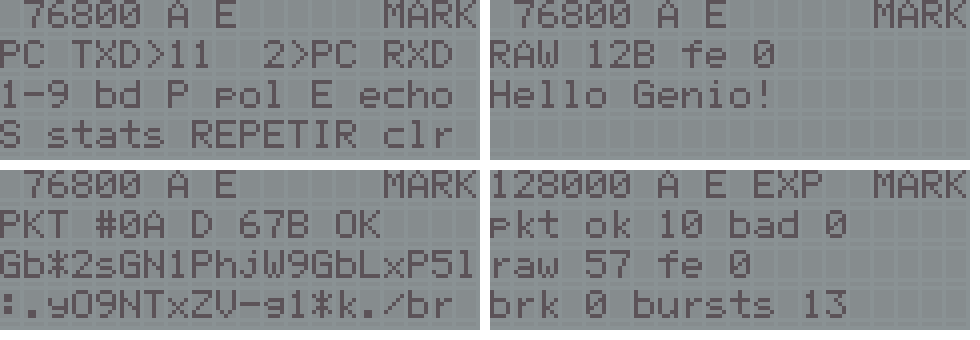

# pc-link: PC -> Genio serial link for the VTech Genio 2000 (Z80 at about 6.13 MHz)

A 16 KiB cartridge (at 0x8000, autostart `55 AA 59 45`; it uses 15.6 KiB) and a Python script, `pclink.py`, that send data **from a PC to the Genio** through the printer port. The project's earlier tools only ever transmitted from the Genio (a software UART on DATA0); here the PC's USB-serial TXD drives the printer **BUSY** input, the cartridge decodes it as a UART (8N1) and answers on DATA0, so the PC can check every byte that arrived. It starts at **76800 baud**, the fastest stable rate.



| Rates | Status |
|---|---|
| **2400, 4800, 9600, 19200, 38400, 57600, 76800** (default 76800) | **stable**: every packet answered at the first try on the owner's unit in every run (2026-11-13) |
| 115200, 128000 | **experimental**: the Genio records the line and decodes it afterwards; 20 of 20 packets at the first try on the owner's unit, but only with a correction (`skew -13`, now the default) measured on that unit; marked `EXP` on the screen and left out of `sweep` unless `--experimental` |

153600, 230400 and 256000 baud were tried (version 3) and removed: 153600 lost packets even with the correction (the adapter sent about 161 000 baud there, and the edges spread by two thirds of a bit), and 230400 and up are beyond what the recording method can resolve.

**Machines.** Written for the Genio 2000. It will most likely also run on the Genius 4000, Genius LEADER 4000 Quadro, Genius LEADER 4004 Quadro L and PreComputer Power Pad (the same ports; HotKey's VGLDK notes describe this very BUSY wiring on a 4000 Quadro), but it has only been run on the Genio 2000, and those machines have other key legends. On another unit, check the experimental rates with `scope` first (see **The scope**).

## Wiring
| USB-serial adapter | | DB25 printer port of the Genio |
|---|---|---|
| TXD | -> | pin 11 (BUSY): port 0x11 bit 5 |
| RXD | <- | pin 2 (DATA0): port 0x10 bit 0 (the same wire the dumper and `hwtest` use) |
| GND | -- | pins 18-25 |

The return wire is optional: without it, `send --no-echo` and `line` still work and you read the result on the LCD. The owner's unit works with plain wires from the adapter (no resistors). HotKey used a 5 V FTDI adapter with a 1 k pull-down from pin 11 to ground on a 4000 Quadro.

## On the Genio
The cartridge starts on a help screen and switches to the main screen on the first data or key:

```
  76800 A E      MARK     rate, BUSY polarity (A/B), E = echo of raw text on, receive offset (9600 only, when set)
                          or EXP (experimental rate), line (MARK idle / SPC low)
PKT #2A D 37B OK          last event: a packet (seq, type, length, CRC result), RAW n bytes + framing errors, BREAK
Hello Genio!              rows 3-4: text received (raw bursts and 'D' packets); LF starts a line, other
                          control codes show as '.', bytes 80-FF are the LCD's own characters
```

| Key | |
|---|---|
| 1 2 3 4 5 6 7 | 2400 / 4800 / 9600 / 19200 / 38400 / 57600 / 76800 baud |
| 8 9 | 115200 / 128000 baud (experimental) |
| P | BUSY polarity A (default: BUSY reads 1 while the line is low, as in HotKey's notes and on the owner's unit) or B |
| E | echo of raw text on / off (packets are always answered) |
| S | statistics page: packets OK / bad, raw bytes, framing errors, breaks, bursts |
| H | help page (wiring and keys) |
| REPETIR | clear counters and text |
| OFF | power off |

A rate key also sets the receive offset back to 0. If the corner shows **SPC** while the PC is idle, the polarity is wrong (or the line is not connected the way the program expects): press P. A line held low for about 2 s (a break) sets 76800 baud, offset 0 and the default skew.

## On the PC
```bash
python3 pclink.py --port /dev/ttyUSB0 line              # 1: break on/off every second; the corner must follow (SPC/MARK)
python3 pclink.py --port /dev/ttyUSB0 send "Hola Genio"  # 2: raw text, shown on the LCD and echoed back
python3 pclink.py --port /dev/ttyUSB0 term               #    type lines interactively
python3 pclink.py --port /dev/ttyUSB0 ping               # 3: statistics packet
python3 pclink.py --port /dev/ttyUSB0 test -n 100        # 4: random packets of 1-240 bytes, each answered with its echo
python3 pclink.py --port /dev/ttyUSB0 sweep -n 20        # 5: the same at each stable rate, then back to 76800
python3 pclink.py --port /dev/ttyUSB0 sweep --experimental -n 20   #    also 115200 and 128000
python3 pclink.py --port /dev/ttyUSB0 margin -n 10       # 6: at 9600, shift the Genio's receive timing -7..+7 %, back to 76800
python3 pclink.py --port /dev/ttyUSB0 baud 57600         #    change both ends; later calls need --baud 57600
python3 pclink.py --port /dev/ttyUSB0 reset              #    3 s break: the Genio goes back to 76800 baud
python3 pclink.py --port /dev/ttyUSB0 scope 128000       # 7: record a known pattern at an experimental rate, measure it
python3 pclink.py --port /dev/ttyUSB0 skew -13           #    capture decoder correction in T (the default)
```
Every command assumes the Genio is at 76800 baud unless `--baud` says otherwise (after `baud 9600`, for instance, add `--baud 9600`). Needs pyserial (`python3-serial`) for `--port`. The steps go from the physical layer up: `line` needs neither the UART timing nor the return wire. Non-ASCII characters (`ñ`) are sent as `?` by `send` and `term`.

`sweep` gives up a rate after 5 failures in a row (`--give-up`); if the Genio no longer answers, it sends the 3 s break and carries on at 76800. `margin` asks the Genio (packet `T`) to receive at 9600 baud with its bit time 1 % ... 7 % longer or shorter, sends `-n` packets of 100-240 bytes at each offset (stopping after 3 failures in a row) and prints the window that works: its centre is the clock difference between the adapter and the Genio, its half-width the margin left. The Genio keeps transmitting at the nominal rate, so the PC always understands the answers; if it stops understanding the PC, it goes back to offset 0 after about 4 s.

`--skew PERCENT` (send faster or slower) is only meaningful with `--mame`: a real UART sends and receives at the same rate, so on the cable it also shifts the PC's receiver and the Genio's answers are lost; `margin` shifts the Genio instead.

### The scope
`scope RATE` (115200 or 128000): at 76800 baud the script asks the Genio (packet `K`) for one recording at RATE, switches the adapter to RATE, sends the preamble and a known pattern (alternating bits, long runs, single bits of both levels, a ramp), switches back and reads the 4352 samples (544 bytes, packets `R`). It finds the bytes the way the Genio does and times every level change from its byte's start edge against where the pattern puts it, separately for falling (to low) and rising (to high) changes: their mean offset and spread, the bit time measured from the falling edges (the adapter's real rate, taking the Genio's clock as 6.13179 MHz), and how many changes are more than half a bit off. The recording is saved as `scope_RATE.txt` (one line of 128 samples per block, 1 = low; the header lists the bytes sent). If rising and falling changes are offset from each other it suggests `skew N`, which the capture decoder then adds to every rising change (packet `W`, -40 .. 40 T). The ±8 T that the 16 T sampling adds to each edge averages out over the few hundred edges of a recording.

### Protocol
A burst is whatever arrives until the line has been idle for 6 ms (or 3 characters at 2400 baud), at most 256 bytes. The PC sends packets as `FF FF A5 5A type seq len payload CRC16`; the CRC (CRC-16/CCITT-FALSE, little endian) covers `type seq len payload`, the payload is at most 240 bytes. The leading `FF` bytes have no falling edge inside them, so a receiver that wakes up in the middle of one simply waits for the next start bit (without them, a packet that started while the Genio was scanning its keyboard was received out of frame, seen in MAME). The Genio skips leading `FF`s; a burst that then begins with `A5 5A` is a packet, anything else is raw text. At the experimental rates the preamble is about 2 ms of `FF`, then `00 FF FF`, and a packet must fit in one 11.4 ms recording: at most 121 payload bytes at 115200 and 136 at 128000 (`pclink.py` keeps to that).

| Type | Payload | Answer (same format, without the preamble) |
|---|---|---|
| `D` | text | `A` with the same payload |
| `P` | - | `A` with 15 bytes: version (6), baud index, polarity, echo, then packets OK, bad, raw bytes, framing errors, breaks (16 bits LE), receive offset (signed %) |
| `C` | - | clears the counters, `A` with the statistics |
| `B` | baud index 0-8 | `A` with the statistics at the old rate, then the Genio switches (offset back to 0); if no valid packet comes within about 4 s it goes back |
| `T` | offset, signed %, -7..+7 (9600 baud only) | `A` with the statistics, then the Genio receives with that offset; same 4 s fallback |
| `K` | baud index 7-8 | `A` with the statistics; then the Genio waits up to about 3 s for a sync byte at that rate, records, packs the recording (1 bit a sample) and goes back to listening at its own rate |
| `R` | page 0-2 | `A` with 240 bytes (64 for page 2) of the packed recording |
| `W` | skew, signed T, -40..40 | `A` with the statistics; capture decoder correction for rising changes |
| other / bad | | `N` with reason (1 CRC, 2 length, 3 type) and the number of bytes received |

It is stop-and-wait: the PC sends the next packet only after the answer (or after a timeout, and then retries up to 3 times). The Genio updates the LCD before answering, so it is already listening when the next packet comes (version 2 drew after answering a `T` packet and lost the next packet on the unit; MAME's bridge, which delivers the PC's bytes a frame later, hid it). A raw burst is echoed byte for byte when echo is on.

## How it works
Everything runs with interrupts disabled. `gen_serial.py` generates the receive and transmit routines as lists of (instruction, T-states) at 6.13179 MHz and asserts their timing.

* **2400-19200 baud** (`rx_<baud>_<a|b>`, one routine per polarity): waiting is three `IN A,(11h) / AND B / JP NZ` checks (25 T each) and a timeout counter (24 T) per pass, so the line is sampled at gaps of 25, 25 and 49 T, a mean latency of 18.4 T after the edge; the line must be at mark before a start bit counts. A byte is a re-check of the start bit at half a bit (a glitch sends it back to waiting), the 8 data bits at 1.5 ... 8.5 bits and the stop bit at 9.5 bits, all measured from the IN that saw the edge and shifted back by the mean latency. Each sampling instant is within 3 T of the ideal one (at 9600 baud a bit is 638.7 T); delays are `LD A,n / DEC A / JP NZ` loops plus `NOP` / `LD A,0` padding. Storing the byte and returning to the waiting loop takes 66 T from the stop-bit sample; the next start edge comes half a bit later (160 T at 19200), which the generator also asserts. The buffer is the 256-byte page C800-C8FF, so `INC L` both advances and detects a full buffer. A stop bit at space counts a framing error; if the line then stays low longer than the burst timeout, the burst ends as a **break** (that is how `line` is seen).
* **38400, 57600, 76800 baud** (`rx_fast`): eight checks of 25 T between counter updates (`DEC E / JP NZ`, a 39 T gap; every 256 passes `DEC D` adds 14 T), mean latency 13.8 T. The stop bit is not sampled: storing the byte and getting back to the waiting loop (71 T from the last data sample) happens while it is on the line, and the next start edge is 1.5 bits after that sample (120 T at 76800). So there are no framing errors and no break detection at these rates; a wrong byte is caught by the packet CRC. At 76800 a bit is 79.8 T and the detection latency varies between 0 and 39 T around its mean: little margin on paper, yet every packet passed on the unit.
* **Receive offsets** (`rx_9600_a_m7` ... `rx_9600_a_p7`): the 9600 baud polarity A receiver generated again with the bit time 1 % ... 7 % longer (`p`) or shorter (`m`), for `margin`. Only at 9600: each receiver is about 300 bytes.
* **Experimental 115200 and 128000** (`rx_capture`, `cap_scan`, `cap_decode`): at 53 T a bit there is no time to poll, sample and shift. The Genio waits for the sync byte `00` (the line low for about 6 bits) and from its stop bit records port 0x11 with 4352 `INI`s, unrolled by 128, into CA00-DAFF: one sample every 16 T (14 T more after each block, for the loop counter), 11.4 ms whatever the rate. `cap_scan` (assembly, 45 T a sample) turns the recording into the distances between level changes (C200-C7FF), and `cap_decode` (C, about 0.1 s) rebuilds the bytes: a change to low is a start edge, placed half a sample before the sample that shows it, and every later change within 9.5 bits is put on the nearest bit boundary, so each bit gets the level of its run, not of one sample (a sample is up to a third of a bit away from the middle at 115200). Rising changes are first moved by the skew. The two `FF` after the `00` give the recording time to start before the packet does. `INI` is the fastest way the Z80 has to read a port and store the value; with 16 T samples (30 T at the block gaps) the method cannot place edges at 230400 baud (26.6 T a bit), and a simulation of the decoder failed every packet there even with an ideal line.
* **The skew**: on the owner's unit the scope found the rising changes 11.6 T (1.9 us) early compared with the falling ones at 128000 baud: the BUSY input sees a falling line later than a rising one. A constant like that shifts every bit that ends in a rise by a quarter of a bit at 128000; `skew -13` puts them back. It is the default, and a break restores it. It is a property of that unit (and maybe of its adapter): on an ideal line (MAME without the model below) the default skew itself makes a third to a half of the packets fail at the experimental rates, so measure another unit with `scope` and set its own value.
* **Transmitting** up to 76800 baud: as the hardware-tested transmitter of the dumper / `hwtest`, port 0x10 = `FF` for a low line and `00` for a high one, then `OUT (11h),FF`; it sends no STROBE pulse, so port 0x12 is never touched. Bit edges within 3 T of the ideal, bytes back to back with one stop bit, and the line held at mark for one more bit at the end. At 115200 and 128000 (`tx_<baud>`): A holds the inverted byte and each bit is `OUT (10h),A` then `RRCA` (15 T), so the other DATA pins carry the other bits of the byte; no `OUT (11h)`; stop bit 1 bit.
* **Back to the default**: if the line has been low for about 2 s (80 receive calls that found no idle line), the Genio sets 76800 baud, offset 0 and the default skew. `pclink.py reset` sends that break, and `sweep` uses it when a rate leaves it without an answer.
* The keyboard is scanned only between bursts (when no start bit came for 50 ms), and only columns 1-7: selecting column 0 would drive DATA0 low and send garbage to the PC. No key used by the program is in column 0.

## Build
```bash
make VGLDK=/path/to/vgldk   # an unmodified clone of VGLDK at commit 6fbd389
```
VGLDK's gl2000 profile trimmed to the LCD driver (as in `diagnostico`), with its own LCD map, keyboard scan and power-off routine. `gen_serial.py` writes `serial.h` and prints the sampling instants and bit edges of every routine; `mkcart.py` checks the layout (code below BFFC, nothing in `_HOME`, globals below the buffers), stores the CRC-32 of 8000-BFFB at BFFC and writes `pclink_gl2000_16K.bin` and `pclink_gl2000_mirrored_AT28C256_32K.bin` (for MAME's `-cart` or an AT28C256).

## MAME tests
The `genio2000` driver has no printer port, so `tests/bridge.lua` is a virtual cable: a read tap on port 0x11 puts the PC's UART waveform on bit 5 at the emulated instant of each `IN` (or `INI`), and a write tap on port 0x10 timestamps DATA0 and decodes it as a UART. `pclink.py --mame DIR` talks to it through files in DIR (`ctl.txt` commands, `rx.bin` received bytes), so the same script and protocol code are tested. The bridge also logs the LCD rows (from the HD44780's DDRAM), takes snapshots, presses keys of the emulated matrix and measures the answer latency. It can model a slow BUSY input: `EN_FALL_US` delays the falling edges, `EN_RISE_US` the rising ones. `tests/run_mame.sh` uses `EN_FALL_US=1.9` by default, the line the scope saw on the owner's unit (with it, MAME's scope measures rising changes 12.1 T early; the unit gave 11.6 T). `PCLINK_DEBUG=1` prints every send, reply and ignored byte.

```bash
make test                              # = tests/run_mame.sh: headless MAME + tests/check.sh
EN_INVERT=1 tests/run_mame.sh DIR      # BUSY of the opposite polarity: must fail until P is pressed
EN_FALL_US=0 tests/run_mame.sh DIR     # an ideal line (the experimental rates then fail with the default skew)
EN_CHECK=tests/tolerance.sh tests/run_mame.sh DIR    # the baud tolerance table below
```
`GENIO_MAME` and `GENIO_ROMPATH` select a MAME with the `genio2000` driver (default `mame`) and your own ROMs (default `roms`); MAME runs throttled (real time, so the script's timeouts mean the same as on the cable), with no display, dummy SDL drivers, `-video none -sound none`.

## Status
### On the real unit (the owner's Genio 2000 and USB-serial adapter, 2026-11-13, polarity A, no resistors)
* **Version 1**: `sweep -n 20` at 2400, 4800, 9600 and 19200 baud, 20 of 20 random packets each answered first time with the right echo, 0 stray bytes; 106, 203, 371 and 630 payload bytes per second each way. So the BUSY input follows the adapter's TXD with the polarity HotKey described for the GL4000 (bit 5 = 1 while the line is low), and the receive timing computed for 6.13179 MHz is right.
* **Version 2**: `line` (the corner followed every break), `send` and `term` with echo, `ping`, `test -n 10`, and `sweep -n 10` at all seven rates 2400-76800, 10 of 10 packets first time each, 0 stray bytes; 105, 201, 366, 618, 944, 1145 and 1291 payload bytes per second each way. `margin -n 10`: -5 % .. +4 % worked and -7, -6, +5, +6, +7 % failed, exactly the window MAME gives (centre -0.5 %), so the adapter and the Genio's clock agree to well within 1 %.
* **Version 3**: `margin` clean (0 failures inside the window). Without a skew, 115200 and 128000 passed 17 of 20 packets (many after a retry), 153600 none, 230400 had no link; the break brought the Genio back to 9600 each time.
* **Version 4**: `scope 128000`: bit time 48.01 T (the adapter at 127 714 baud, -0.2 %), falling changes +1.5 T, rising changes -11.6 T (-1.9 us), 1 change of 607 more than half a bit off. `scope 153600`: the adapter at about 161 000 baud (+4.9 %), a spread of about 25 T (two thirds of a bit), 213 changes off. With `skew -13`: `sweep` at 115200 and 128000, 20 of 20 packets first time each (251 and 250 payload bytes per second); 153600 19 of 20, 7 of them after a retry.
* **Version 5** (153600 and up removed, `skew -13` built in, experimental rates marked): `sweep --experimental -n 20`, 20 of 20 packets first time at each of the nine rates, 0 stray bytes; 106, 204, 372, 632, 974, 1184 and 1336 payload bytes per second each way from 2400 to 76800, 251 at 115200 and 250 at 128000.

* **Version 6** (this one; starts at 76800 baud and goes back to it after a break, otherwise the same routines as version 5) has not been run on the unit.

### In MAME only (`genio2000-dev` build, 6.13179 MHz; `tests/check.sh` with the unit's line model, 38 steps, all pass; logs and snapshots go to `mame/run/`)
`ping` at the default 76800; 10 separate `ping`s each answered at the first try (the first packet after an idle period); raw `send` with echo; 40 random packets at 76800 with their echoes; 20 packets with the PC 3 % fast and 20 with it 3 % slow; `line` (3 breaks counted); `sweep` (12 packets at each stable rate) and `sweep --experimental` (also 115200 and 128000), all first time; `scope 128000`; `margin` (window -5 % .. +4 %); `baud 57600` then `reset` (back to 76800); 19200 with the PC 2 % fast and 2 % slow; the baud keys (19200, 115200, 128000, 9600, 76800; `EXP` shown at the experimental ones), echo off and the statistics page; polarity B (`EN_INVERT=1`: no answer until P is pressed, then it works). The Genio's transmitted bit measures 104.162 us at 9600 baud (nominal 104.167 us) in the bridge's decoder.

* Throughput in MAME: about 105, 195, 345, 550, 805, 935 and 1015 payload bytes per second each way from 2400 to 76800 baud, and about 220-250 at the experimental rates, where the fixed 11.4 ms recording, the 0.1 s decoding and the smaller packets cost more than the faster line saves. So 76800 is also the fastest rate in practice.
* Baud tolerance in MAME, ideal line (failed packets out of 6, payload 100-240 bytes, PC clock off by the given percentage; the Genio's answers are decoded at the nominal rate):

  | baud | -7% | -6% | -5% | -4% | -3% | -2% | 0% | 2% | 3% | 4% | 5% | 6% | 7% |
  |---|---|---|---|---|---|---|---|---|---|---|---|---|---|
  | 2400 | 6 | 6 | 0 | 0 | 0 | 0 | 0 | 0 | 0 | 0 | 0 | 6 | 6 |
  | 4800 | 6 | 6 | 0 | 0 | 0 | 0 | 0 | 0 | 0 | 0 | 6 | 6 | 6 |
  | 9600 | 6 | 6 | 0 | 0 | 0 | 0 | 0 | 0 | 0 | 0 | 6 | 6 | 6 |
  | 19200 | 6 | 6 | 0 | 0 | 0 | 0 | 0 | 0 | 0 | 6 | 6 | 6 | 6 |

  A fast PC fails first at 19200 (probably because the next start edge then arrives before the routine is back in its waiting loop). Table in `tests/tolerance.txt`.

### Limits and risks
* The BUSY input's edges were measured only indirectly, by the scope at 128000 and 153600 baud with one adapter; the skew may differ with another adapter, cable or unit, and the experimental rates depend on it.
* MAME does not emulate the printer port; the bridge's line is ideal apart from the delay model. USB-serial adapters that leave gaps between bytes are not modelled (a gap shorter than 6 ms stays in the same burst).
* The keyboard is only read between bursts, every 50 ms or so; a key tap shorter than about 100 ms can be missed. While a burst is being received or answered, OFF is not seen.
* LCD writes are at least 341 T (56 us) apart; the busy flag is not read. No undocumented opcodes. No `HALT` except the power-off routine (the only write to port 0x12, bit 0 set on purpose). Ports 0x00-0x06 are never written; port 0x10 is written with column bits 1-7 (keyboard), `00`/`FF` (DATA0 up to 76800 baud) or, by the 115200/128000 transmitter, the rotated byte (its bit 0 is DATA0, the others only select keyboard columns); port 0x11 only with `FF`, as the firmware does at boot. `INI` reads port `(C)` with B on the upper address lines; `IN A,(11h)` puts A there and works on the unit, so the upper byte does not matter.

Licence: GPL-3.0-or-later (it is built against VGLDK), copyright (c) 2026 Santiago Crespo.
