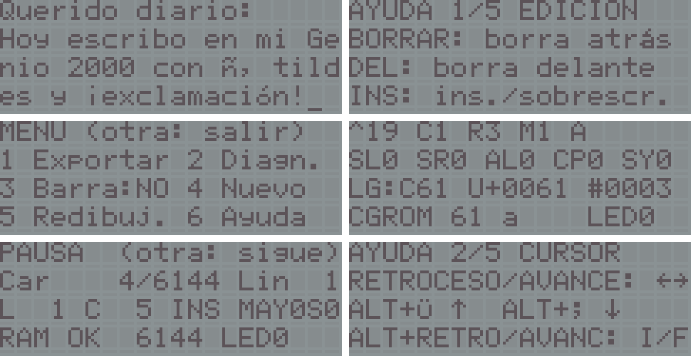

# text-editor: a 4 x 20 text editor for the Spanish Genio 2000

A text editor with the functions of the physical keyboard, a built-in keyboard diagnostic and export of the text to a PC (UTF-8 with CRC) through the DB25 printer port. Built for VGLDK's `gl4000` target with the profile `-DGENIO_ES -DGENIO_NATIVE_CGROM` (see `../vgldk-genio`). **It does not modify the internal firmware and it does not write any EEPROM.**



> **STATUS: tested on a real Genio 2000 by the author,** after being developed and tested on a PC and in the original project's Z80 simulator. The power-off sequence, the reading of OFF and the T642 serial transmission had already been validated on hardware in earlier ROMs. The checklist in [`docs/TESTING_ON_THE_UNIT.md`](docs/TESTING_ON_THE_UNIT.md) is the procedure for repeating the checks on a unit (results are not itemised here). A hardware test also confirmed that bit 5 of port 0x12 drives the caps-lock LED (`../../docs/firmware/HW_RESULTS_20261110.md`).

The on-screen texts (help pages, menus) are in Spanish on purpose: they match the legends printed on the Spanish unit's keys.

## Contents
| | |
|---|---|
| `src/` | `genio_text_editor_gl4000.c` plus the portable modules `ge_*.h` (keymap, key-state matrix, gap buffer, protocol, Unicode) |
| `receiver/` | `ge_rx.py`, the PC-side receiver (Python 3 + pyserial) |
| `docs/` | `PROTOCOL.md`, `MEMORY.md`, `LED_AND_POWEROFF.md`, `TESTING_ON_THE_UNIT.md` |
| `Makefile` | builds the 32 KiB AT28C256 image (needs the VGLDK layer, see below) |

The original project also had a test suite (host tests, a full Z80 simulation and mutation tests), a generator for the complete keyboard table and a memory report. They depend on private data of the original working tree and are not included. The keyboard matrix and legends are documented in [`../../docs/hardware/KEYBOARD.md`](../../docs/hardware/KEYBOARD.md).

## Build
```bash
git clone https://github.com/hotkeymuc/vgldk && git -C vgldk checkout 6fbd389
cp -r ../vgldk-genio/include vgldk/ && (cd vgldk && patch -p1 < ../../vgldk-genio/vgldk-genio.patch)   # see ../vgldk-genio/README.md
make VGLDK=$PWD/vgldk        # -> genio_text_editor_gl4000_AT28C256_32K.bin
```
The image is 16 KiB of code repeated twice (the CPU only sees the `0x8000-0xBFFF` window);. Built this way from these sources the first 16 KiB are byte-identical to the original build. The ready-made image is in `../../release/` (the one that was tested). Check its SHA-256 before burning it yourself.

## Connection (Genio -> PC transmit only)
`DB25 DATA0 (pin 2) -> CP2102 RXD` and a common ground. **BUSY (pin 11) is not used and the CP2102's TXD is not connected** (it prevents the Genio from starting). 9600 8N1, T642 timing.
```bash
python3 -I receiver/ge_rx.py --port /dev/ttyUSB0 --outdir captures/run1
python3 -I receiver/ge_rx.py --input raw_capture.bin --outdir captures/run1     # without hardware
```
The receiver only receives; it saves `export_NNN.txt` (+ SHA256), `key_events.jsonl`, `modifier_events.jsonl`, `led_events.jsonl`, `protocol_errors.jsonl` and `raw_stream.bin`.

## Using the editor
| Key | Action |
|---|---|
| letters, digits, signs | according to the legends: no modifier (blue), **SHIFT** (red, left), **ALT** (red, right) |
| BLOQ. MAYUSCULAS | caps lock + **LED**; SHIFT inverts it for letters; ALT keeps working |
| ALT+vowel / SHIFT+ALT+vowel | á é í ó ú / Á É Í Ó Ú (also with BLOQ) |
| INTRO | new line |
| REPETIR/BORRAR | deletes the previous character; **SHIFT+** = REPETIR (repeats the last character) |
| JUGADOR DERECHA/DEL | deletes the next character |
| JUGADOR IZQUIERDA/INS | insert / overwrite (underline / blinking block cursor) |
| RETROCESO / AVANCE | cursor left / right (with SHIFT they type `<` `>`) |
| ALT+Ü / ALT+; | cursor up / down (with SHIFT: page); ALT+RETROCESO / ALT+AVANCE: start / end of line |
| AYUDA | 5-page help (left/right to turn pages; another key leaves); SHIFT+AYUDA: tab (to a multiple of 4) |
| SHIFT+PAUSA | status screen (PAUSA); PAUSA alone types `^` |
| RESPUESTA | menu: 1 export, 2 diagnostic, 3 status bar, 4 new, 5 redraw (reinstalls the accents), 6 help |
| IMPRIMIR TEXTO (panel) | export the document to the PC |
| ALT+Ñ | clear everything (asks for INTRO) |
| ALT+Q / S / D / F / G | root + - x division; pi: ALT+BLOQ. MAYUS and then A (one use) |
| OFF (panel) | switches off (hold about 1.4 s; verified routine) |

**Diagnostic** (menu 2): for every press and release it shows the key identifier, position (col_out, row_in, matrix), left/right SHIFT, ALT, BLOQ and SYM state, logical code, Unicode and CGROM code / CGRAM slot, and sends it through the DB25 (one frame per change; LED changes too). Leave by **holding RESPUESTA about 1.5 s** (the document is not touched).

## Decisions and findings
* **The matrix and the combinations come from the unit's original firmware** (four keyboard tables and the ALT table in the verified dump), not from a PC keyboard or from VGLDK. `keyboard_es.h` had `;` and `'` swapped.
* The two MAYUSCULAS keys are **the same intersection** of the matrix (the firmware reads only one): the diagnostic cannot tell left from right.
* The firmware ignores SHIFT with ALT; here `SHIFT+ALT+E = É` (an extension, still to be checked).
* Own keyboard layer (`ge_matrix.h`): it keeps the state of **every** key (13 rows x 8 columns), two-reading debounce, repeat (0.5 s + 0.1 s, only for the last non-modifier key) and ghost detection for matrix rectangles (no diodes).
* LED: VGLDK's `led.h` does `led_port |= 0x20` without protecting bit 0 of port 0x12 (the power-off bit). `ge_led_set()` does a read-modify-write like the firmware **forcing bit 0 to 0**. See `docs/LED_AND_POWEROFF.md`.
* Line wrap by characters (20 columns), no horizontal scrolling; see `docs/MEMORY.md`.
* Accented capitals: CGRAM slots 0-3 with a thin 2 px accent and row 7 empty, written raw (code 0x00 never goes through a C string or `lcd_putchar`). Everything else uses the native CGROM.

Licence: GPL-3.0-or-later (built against VGLDK, see `../README.md`).
